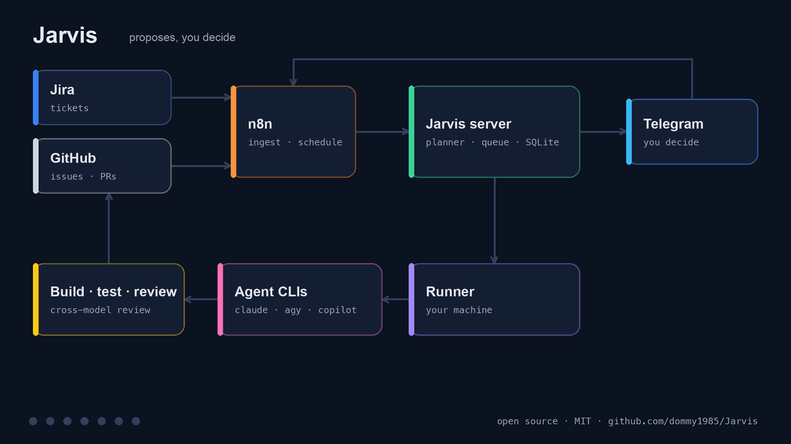

# I had more tasks than hours, so I built an assistant that decides what an AI should do about them



Every morning I faced the same pile: tickets in Jira, issues on GitHub, several repositories, small bugs next to tasks that need hours. And very little time to follow the work.

At the same time, AI coding tools had become genuinely good. I use more than one: Claude Code, Antigravity, GitHub Copilot CLI. Each has its strengths, its own quota limits and its own interface. The bottleneck was no longer writing code. It was **deciding what to do today, who should do it, and checking the result**.

So I built Jarvis.

## The idea: Jarvis proposes, I decide

Jarvis is a small self-hosted assistant with one rule: nothing irreversible happens without my approval.

Every morning it collects my tasks, asks a model to propose **what to do today and with which tool**, based on the hours I actually have, and posts a briefing in a Telegram topic. I answer with short commands:

```
1. [PROJ-412] Fix crash on token refresh  → Claude Sonnet
2. [my-app #31] Update dependencies       → Antigravity
3. [my-app] Migrate the profile screen    → I'll do it myself

> ok
> 2 haiku        (change the executor)
> go 1           (queue it)
> go 4 plan      (read-only plan first, then I decide)
```

Whatever I approve is run by a **runner** on my own machine. For every task it creates an isolated git worktree, starts the chosen agent, runs build and tests, asks a model from a *different* family to review the diff, and opens a **draft pull request**. It never pushes to a main branch.

## The architecture

The animation above shows the path of a task. In words:

- **n8n** does what it is good at: it collects tasks on a schedule and forwards my Telegram replies.
- **The server** (Python, SQLite, a single dependency) holds tasks, briefings and the queue. The only model call of the day is the one that writes the briefing; everything else is deterministic code. My commands are parsed without any model.
- **The runner** executes work where my repositories and my already-logged-in CLIs live. It talks to the server over an SSH tunnel, or directly when everything runs on one machine.
- **Providers** are adapters. Every CLI sits behind the same small interface. If one runs out of quota or is not installed, the run moves to the next provider in an ordered fallback list. Adding a new one means writing one file.

## The decisions that matter

- **Safety first.** Agents never push. The runner pushes only `agent/<id>` branches, and it blocks commits that contain files that look like secrets.
- **Only tasks I chose.** Only tasks I created, or labelled, enter the queue, so a malicious ticket cannot enqueue itself.
- **Official CLIs, my own subscriptions.** No API keys handed to third parties.
- **Cross-model review.** One family's work is reviewed by another, with one fix round for serious problems.
- **Plan before code** for delicate tasks: the agent writes a read-only plan that I approve, revise or discard.

## How I built it

I built Jarvis together with AI agents, under strict rules. Every step was a self-contained issue, so one agent could pick up exactly where another stopped (handy when a quota runs out). Each agent worked in its own git worktree. A read-only "advisor" reviewed the work before every merge. And the tests earned their keep: the CI of the public repository immediately found tests that only passed on my laptop, because they depended on the CLIs and git settings I happened to have installed.

The least glamorous part of open-sourcing it was also the most important: removing names, hosts and identifiers, and scanning the whole history for secrets before the first public commit.

## It is open source

Jarvis is on GitHub under the MIT license: **https://github.com/dommy1985/Jarvis**

It runs on one machine, or with the server on a VPS and the runner on a laptop. It speaks English and Italian, and there is a guide for adding a provider.

I would rather tell you what is missing. Ingest and scheduling currently need n8n. Part of the code comments are still in Italian. I have not tried every install path on clean machines, so if the quickstart breaks for you, please open an issue.

If you also have more tasks than hours, take a look. And if you feel like writing an adapter for another tool, say Codex, there is already an issue to start from.
